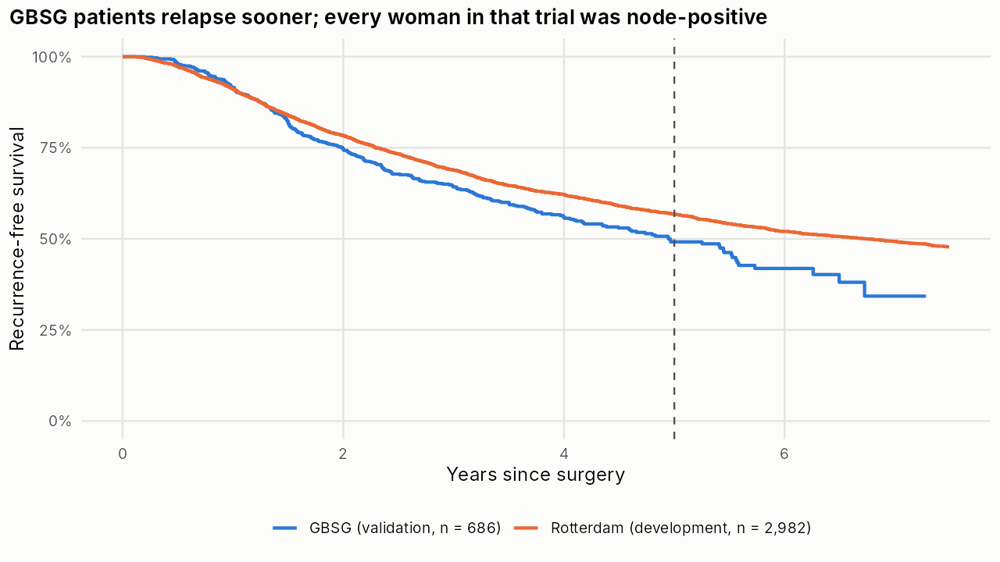
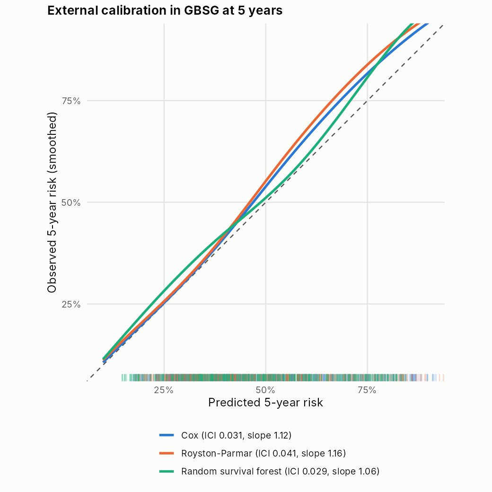
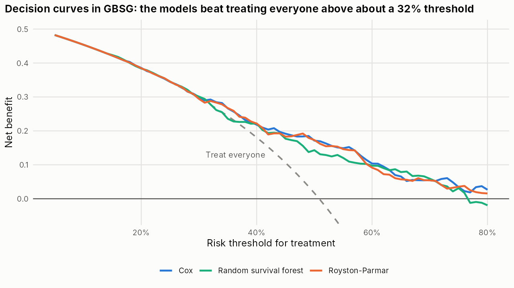
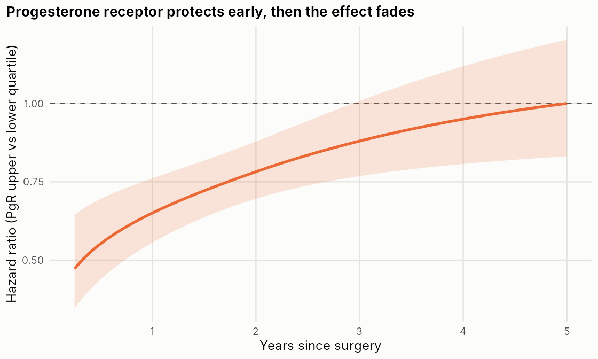

# Does a more flexible survival model hold up better in new patients?

**Developing a 5-year breast cancer recurrence model in Rotterdam (n = 2,982) and testing it on German trial patients (GBSG, n = 686): Cox vs Royston–Parmar vs random survival forest**

A prognostic model is only useful if it works on patients it was not built on. This project develops three models for recurrence-free survival after breast cancer surgery: a Cox model, a Royston–Parmar flexible parametric model with time-varying effects, and a random survival forest. Each is fitted on a Dutch hospital cohort and then validated, without refitting, on an independent German trial cohort. The validation follows the STRATOS guidance for survival prediction models: discrimination, calibration, overall accuracy and clinical usefulness, all at 5 years.

## Main findings

1. **More flexibility did not help in new patients.** In GBSG the Cox model has the best discrimination (Harrell's C 0.692). The Royston–Parmar model is slightly lower (0.688; difference −0.004, 95% CI −0.007 to −0.001), and the random survival forest is lower still (0.676; difference −0.017, −0.029 to −0.003). The Cox model also has the best overall accuracy (index of prediction accuracy 0.164, against 0.157 and 0.132).
2. **The time-varying effects are real but don't change 5-year predictions.** Hazards are clearly not proportional over time for progesterone receptor (PgR), oestrogen receptor and nodes (p < 0.001 for each). Allowing these effects to change over time improved the Royston–Parmar fit by 50 AIC points. Patients with high PgR have about half the hazard of low-PgR patients early on (HR 0.47 at 3 months), but by year 5 the effect is gone (HR 1.00; figure 4). That matters for understanding the biology, but it did not improve the 5-year risk predictions.
3. **The forest overfits most, which internal checks reveal.** Its C-index on the training data is 0.782, but its out-of-bag estimate is 0.691, and in GBSG it scores 0.676. For the Cox and Royston–Parmar models, the bootstrap estimates of overfitting (optimism) are tiny (0.002), and they lose only 0.002–0.005 more in GBSG.
4. **All three models are reasonably calibrated in GBSG, despite the case-mix difference.** Observed 5-year risk in GBSG is 50.8%, against 47.5–48.8% predicted (observed/expected ratio 1.04–1.07). Calibration slopes are slightly above 1 (1.06–1.16). That means the risk spread in GBSG is a little wider than the models predict, so high-risk patients are under-predicted. Adjusting only the overall risk level brings the mean calibration error (ICI) down from 0.029–0.041 to 0.016–0.024.
5. **Using a model only helps when the treatment threshold is high.** In decision curve analysis, the Cox and Royston–Parmar models beat "treat everyone" once the risk threshold for treatment passes about 32%; the forest needs about 38%. Below that, most GBSG patients are above the threshold anyway, so the models change few decisions.
6. **Matching eligibility barely changes anything.** Every GBSG patient had positive lymph nodes, against 52% in Rotterdam. Re-developing on the 1,546 node-positive Rotterdam patients gives external C-indices of 0.695, 0.690 and 0.681: the same ranking of models and nearly identical performance.

## Data

Both datasets come with R's `survival` package (Therneau) and are included in `data/raw/` as CSV exports.

| | Rotterdam (development) | GBSG (validation) |
|---|---|---|
| Source | Rotterdam tumour bank, all patients with primary breast cancer | German Breast Cancer Study Group trial, node-positive patients |
| Patients | 2,982 | 686 |
| Recurrence or death within 5 years | 1,275 | 285 |
| 5-year event risk (Kaplan–Meier) | 43.2% | 50.8% |
| Node-negative | 48.2% | 0% |
| Tumour > 20 mm | 53.5% | 73.8% |
| Grade 3 | 73.4% | 23.5% |
| Hormone therapy | 11.4% | 35.9% |

Full table: `results/tables/01_case_mix.csv`.

**Outcome:** recurrence-free survival, defined as time from surgery to recurrence or death, whichever came first. 195 Rotterdam women died without a recorded recurrence; they count as events at their death time. Follow-up is cut at 5 years.

**Check against the literature:** the event counts (1,275 and 285) exactly match those in McLernon et al. (2023), which uses the same data and outcome.

**Harmonising the two datasets:**
- Rotterdam records tumour size only in bands, so GBSG sizes are banded the same way (≤20, 20–50, >50 mm).
- Rotterdam has no grade 1 tumours, so grade is coded as 3 vs 1–2.
- Node counts and receptor levels are log-transformed after capping extreme values (nodes at 20, PgR and ER at 1,000 fmol/l).
- Grading differs between the two studies (73% grade 3 against 23.5%), which is a known source of difference, not a coding error.



## Methods

**Predictors (all models):** age (natural spline, 3 df), menopausal status, tumour size band, grade, log(nodes + 1), log(PgR + 1), log(ER + 1), hormone therapy. The forest uses the untransformed variables, since trees don't need transformations.

| Model | Specification | How it was chosen |
|---|---|---|
| Cox | Proportional hazards, same predictors | Linear age vs spline compared by AIC: the spline is better by 18 points |
| Royston–Parmar | Spline for the log cumulative baseline hazard (2 df) plus time-varying effects for PgR, nodes and ER, fitted with `rstpm2` | Baseline df 1–5 by AIC. Time-varying effects added forward by AIC (each must improve AIC by more than 2), choosing among predictors whose proportional-hazards test gave p < 0.01 |
| Random survival forest | 1,000 trees, node size 15, 2 variables tried at each split, fitted with `randomForestSRC` | Grid search over node size (5, 15, 30, 60) × variables per split (2, 3, 4) by out-of-bag C-index |

**Internal validation:** 200 bootstrap resamples, each repeating the model fit and measuring how optimistic the training-data performance is (Harrell's method), for the Cox and Royston–Parmar models. The forest uses its out-of-bag estimate instead.

**External validation in GBSG, at 5 years:**
- *Discrimination:* Harrell's C and Uno's C, truncated at 5 years. Bootstrap CIs (1,000 resamples) are given for the differences between models.
- *Overall accuracy:* Brier score with inverse-probability-of-censoring weights, and the index of prediction accuracy (IPA = 1 − Brier / Brier of a no-information model).
- *Calibration:* observed/expected ratio, and calibration slope (Cox regression on the cloglog of predicted risk). Smoothed calibration curves and ICI, E50 and E90 summaries follow Austin, Harrell & van Klaveren (2020).
- *Clinical usefulness:* decision curve analysis (net benefit) for thresholds from 5% to 80%.
- *Updating:* recalibration-in-the-large, i.e. shifting the risk level to match GBSG's observed risk while keeping each model's ranking of patients.

## Results

### Internal validation (Rotterdam)

| Model | Harrell's C on training data | Optimism-corrected C | Calibration slope (corrected) |
|---|---:|---:|---:|
| Cox | 0.696 | 0.694 | 0.98 |
| Royston–Parmar | 0.696 | 0.693 | 1.03 |
| Random survival forest | 0.782 | 0.691 (out-of-bag) | n/a |

### External validation (GBSG, 5 years)

| Model | Harrell's C | Uno's C | IPA | Observed/expected | Calibration slope | ICI |
|---|---:|---:|---:|---:|---:|---:|
| Cox | **0.692** | **0.674** | **0.164** | 1.05 | 1.12 | 0.031 |
| Royston–Parmar | 0.688 | 0.671 | 0.157 | 1.07 | 1.16 | 0.041 |
| Random survival forest | 0.676 | 0.657 | 0.132 | 1.04 | 1.06 | **0.029** |

Standard errors for C are about 0.015. All measures: `results/tables/08_external_validation.csv`.



### Clinical usefulness



### What the flexible model shows that Cox can't



| Years after surgery | 0.25 | 1 | 2 | 3 | 5 |
|---|---:|---:|---:|---:|---:|
| HR, PgR upper vs lower quartile | 0.47 | 0.65 | 0.78 | 0.88 | 1.00 |

A Cox model averages this into one hazard ratio (0.938 per unit of log PgR). The Royston–Parmar model shows the protection is concentrated in the first two years.

## Interpretation

The extra flexibility in both directions, time-varying effects and the forest's nonlinearity, fitted real features of the Rotterdam data. It did not produce better 5-year predictions for German trial patients. With about 1,275 events and eight predictors, a well-specified Cox model already captures most of what is predictable, and the forest's extra freedom mostly fits noise. The time-varying effects would matter more for predictions at 1 or 2 years, or for questions about when risk is concentrated. They matter less for a single 5-year risk.

## Limitations

- **One external cohort.** GBSG is a clinical trial with strict eligibility, so it says how the models transport to node-positive trial patients, not to every new hospital.
- **Grading may not be comparable.** The large difference in grade 3 share (73% against 24%) suggests the two studies graded tumours differently, which weakens the grade predictor in validation.
- **Model selection isn't fully bootstrapped.** The bootstrap repeats the model fits but not the choice of which effects vary over time, so internal optimism for the Royston–Parmar model is slightly underestimated.
- **Old data.** Both cohorts predate modern treatment such as HER2-targeted therapy, so absolute risks do not apply to today's patients. The validation methods are the point.

## Reproduce

```r
# in R, from the repository folder
source("install_packages.R")
source("run_all.R")      # about 3 minutes; writes results/tables, results/figures, results/summary.json
```

Tested with R 4.3.3, survival 3.5.8, rstpm2 1.7.1, randomForestSRC 3.10.0, ggplot2 3.4.4 and jsonlite 1.8.8.

## Repository layout

```
├── run_all.R               # runs everything
├── install_packages.R
├── R/
│   ├── functions.R         # C-index, IPCW Brier/IPA, calibration (O/E, slope, ICI), net benefit, recalibration
│   ├── 01_data.R           # outcome definition, harmonisation, case-mix table
│   ├── 02_models.R         # Cox, Royston-Parmar (selection of df and time-varying effects), RSF tuning, bootstrap
│   ├── 03_validation.R     # internal + external validation, sensitivity analysis
│   └── 04_figures.R
├── data/raw/               # rotterdam.csv, gbsg.csv (from the R survival package)
└── results/
    ├── tables/             # 14 tables: every number in this README
    ├── figures/
    └── summary.json
```

## References

- Royston P, Altman DG. External validation of a Cox prognostic model: principles and methods. *BMC Med Res Methodol* 2013;13:33.
- McLernon DJ, Giardiello D, Van Calster B, et al. Assessing performance and clinical usefulness in prediction models with survival outcomes: practical guidance for Cox proportional hazards models. *Ann Intern Med* 2023;176:105–114.
- Royston P, Parmar MKB. Flexible parametric proportional-hazards and proportional-odds models for censored survival data. *Stat Med* 2002;21:2175–2197.
- Ishwaran H, Kogalur UB, Blackstone EH, Lauer MS. Random survival forests. *Ann Appl Stat* 2008;2:841–860.
- Austin PC, Harrell FE, van Klaveren D. Graphical calibration curves and the integrated calibration index (ICI) for survival models. *Stat Med* 2020;39:2714–2742.
- Vickers AJ, Elkin EB. Decision curve analysis: a novel method for evaluating prediction models. *Med Decis Making* 2006;26:565–574.

## Author

Maclean Acheampong Yeboah, MPhil Statistics, University of Ghana.

## Licence

Code: MIT (`LICENSE`). Data: distributed with the R `survival` package (LGPL); originally from the Rotterdam tumour bank and the German Breast Cancer Study Group.
